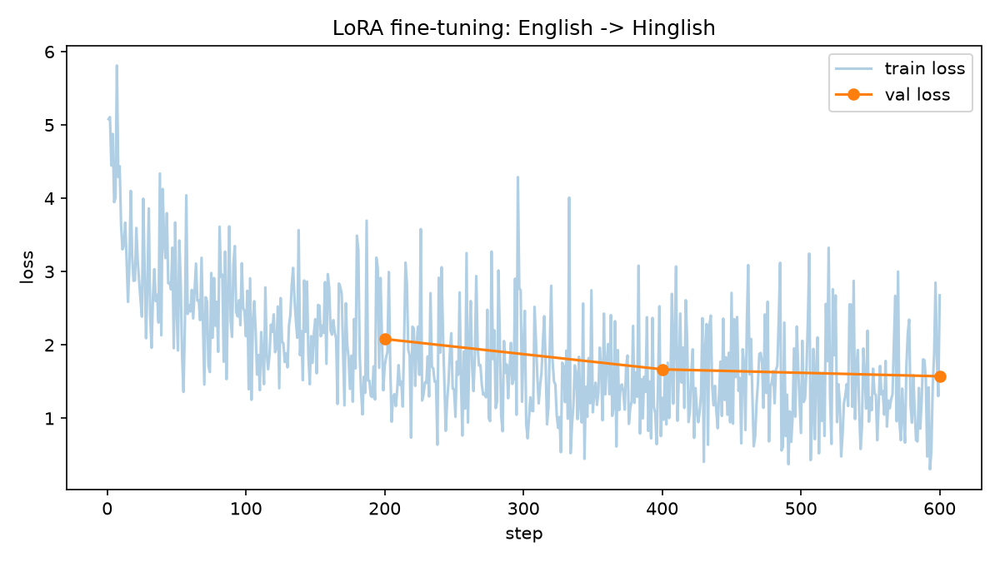

# 🇮🇳 lowrank-hinglish

**LoRA written from scratch (no PEFT library) to fine-tune Qwen2.5-0.5B for English → Hinglish translation, on a MacBook Air.**

> Hinglish = Hindi written in English letters, mixed with English words, the way millions of Indians actually text:
> *"kya ap mujhe aj ke class ka notes bhej sakte hai?"*

🔗 **Live demo:** _coming soon_

---

## TL;DR

- Implemented **LoRA (Hu et al., 2021) from scratch** in ~60 lines of PyTorch: low-rank adapters, injection into a pretrained transformer, and weight merging, verified with unit tests.
- Fine-tuned a **494M-parameter LLM** while training only **0.11%–1.75%** of its weights, on a laptop GPU (Apple MPS).
- Ran **3 controlled experiments** to find out *what actually limits* a small model on Hinglish: **adapter capacity → data domain → base-model size**.
- Honest result: LoRA reliably teaches the model the **style and script** of Hinglish, and fixes assistant-style commands; **casual chat meaning** stays out of reach for a 0.5B model.

---

## How LoRA works (and what I implemented)

A pretrained weight matrix **W** (`out × in`) is **frozen**. LoRA learns a low-rank update instead:

```
y = x·Wᵀ + (α / r) · x·Aᵀ·Bᵀ        A: (r × in),  B: (out × r),  r ≪ in, out
```

- **A** starts random and **B** starts at zero, so `B·A = 0` and the model is **unchanged at step 0**
- Only A and B are trained; W never changes
- After training, `W ← W + (α/r)·B·A` merges the adapter in, giving **zero extra inference cost**

`lora.py` contains `LoRALinear`, `inject_lora()` (swaps chosen `nn.Linear` layers inside the model), `merge()`, and 3 self-tests:

| Test | What it proves |
|---|---|
| Output identical at init | `B = 0` → LoRA doesn't disturb the pretrained model |
| Trainable params = `r·(in + out)` | only A and B learn |
| Merged output == unmerged output | merging is mathematically exact |

On the real model: **48 layers injected, 540,672 of 494,573,440 params trainable (0.109%), output unchanged after injection ✅**

---

## Experiments

| | v1 | v2 | v3 |
|---|---|---|---|
| LoRA layers | q, v | q, k, v, o, gate, up, down | same as v2 |
| Rank r / α | 8 / 16 | 16 / 32 | 16 / 32 |
| Trainable params | 0.54M (0.11%) | 8.8M (1.75%) | 8.8M (1.75%) |
| Training data | 1,600 pairs (assistant commands) | 4,000 pairs (assistant commands) | 4,000 pairs (**real chat**, CMU Hinglish DoG) |
| Steps (batch 4) | 400 | 600 | 600 |
| Val loss | 5.18 → **2.864** | 5.18 → **1.573** | 4.82 → **2.791** ¹ |
| Train time (M-series Air) | 12 min | 5.6 min | 6.5 min |
| Adapter size | 2.2 MB | 35.3 MB | 35.3 MB |

¹ v3 is validated on chat data, which is harder, so its loss isn't directly comparable to v1/v2.



### Evaluation on 30 unseen chat sentences

| Model | Roman script ↑ | Word-overlap F1 vs reference ↑ |
|---|---|---|
| Base Qwen2.5-0.5B | %%base.roman_pct%%% | %%base.word_f1%% |
| v1 | %%v1.roman_pct%%% | %%v1.word_f1%% |
| v2 | %%v2.roman_pct%%% | %%v2.word_f1%% |
| v3 | %%v3.roman_pct%%% | %%v3.word_f1%% |

*Word-F1 is a rough proxy, since Hinglish has no fixed spelling ("mai / main / mein"), so outputs were also judged by a native speaker (below).*

---

## What actually happened (native-speaker review)

**✅ Where LoRA clearly works: assistant-style commands (v2)**

| English | Base model | v2 |
|---|---|---|
| Set an alarm for 7 am tomorrow | — | **kal subah 7 baje ke liye alarm set kare** ✅ |
| What will the weather be like today? | — | **Aaj mausam kaisa hoga** ✅ |
| Play some old Bollywood songs | — | **Bollywood songs ko play kare** ✅ (v1) |

**❌ Where it doesn't: casual chat**

| English | Base model | v2 | v3 |
|---|---|---|---|
| Did you eat lunch? | `Did you eat lunch? - आप लिंकों के साथ चला गया है।` | kya mai lunch chal rahi hai | kya tumhara lunch dekhne ke liye? |
| Can you send me the notes from today's class? | `"Sure! Here is the translation… आप यहाँ की…"` | kya ap mujhe aj ke liye notes bataiye | kya tumne notes ko bhi kya jata hai? |

Native-speaker reference for the second: **"kya ap mujhe aj ke class ka notes bhej sakte hai"**

### Findings

1. **LoRA fixes format immediately.** Even v1 (0.11% of weights) stopped the base model's Devanagari output, rambling and refusals. Every output became Roman-script Hinglish.
2. **More adapter capacity helps (v1 → v2).** Putting LoRA on all 7 projection types at rank 16 cut val loss by 45% and made assistant commands correct.
3. **Data domain decides *style* (v2 → v3).** Training on real chat made the model *sound* conversational ("kya tumne…", "mujhe lagta hai") but it also forgot the alarm skill.
4. **The base model sets the ceiling on *meaning*.** A 0.5B model knows very little Hindi; LoRA can steer what a model already knows, but it can't teach a language from scratch. The natural next step is a ≥1.5B base model, which didn't fit in 8 GB of laptop RAM.

---

## Engineering notes

- **Prompt masking:** loss is computed only on the Hinglish answer tokens (`-100` labels on the prompt), so the model learns to *translate*, not to repeat instructions.
- **Mac GPU memory leak fix:** variable-length batches made Apple MPS memory grow until training slowed from ~10 s to **200+ s per 20 steps**. Calling `torch.mps.empty_cache()` every 10 steps kept it at a steady ~10 s.
- **Checkpoint every eval** so an interrupted run never loses progress.
- **One model, two behaviors in the demo:** the app loads the base model once and toggles the B·A path on and off, instead of holding two 1 GB models in memory.

---

## Project structure

```
lora.py            LoRA from scratch: LoRALinear, inject_lora, merge, self-tests
inject_check.py    injects LoRA into Qwen and verifies param count + unchanged output
prepare_data.py    cleans the English-Hinglish dataset (assistant-style)
prepare_chat.py    builds the chat dataset from CMU Hinglish DoG
train.py           v1 training
train_v2.py        v2 training (all layers, rank 16, checkpoints, MPS fix)
train_v3.py        v3 training (chat data)
hinglish.py        load(adapter) + translate()
evaluate.py        scores base / v1 / v2 / v3 → results/eval.json
app.py             Streamlit demo: base vs LoRA side by side
adapter/           trained adapters + loss curves
```

## Run it

```bash
python -m venv .venv && source .venv/bin/activate
pip install torch transformers datasets streamlit matplotlib
python lora.py                 # LoRA self-tests
python prepare_data.py && python train_v2.py
streamlit run app.py
```

## Data & credits

- [rvv-karma/English-Hinglish](https://huggingface.co/datasets/rvv-karma/English-Hinglish) (Apache-2.0): assistant-style and social-media pairs
- [festvox/cmu_hinglish_dog](https://huggingface.co/datasets/festvox/cmu_hinglish_dog) (CC-BY-SA-3.0): Hinglish movie conversations
- Base model: [Qwen/Qwen2.5-0.5B-Instruct](https://huggingface.co/Qwen/Qwen2.5-0.5B-Instruct)
- Method: Hu et al., 2021, *LoRA: Low-Rank Adaptation of Large Language Models*

---

Built by **Abhipsa Rout**, B.Tech CSE, Manipal University
